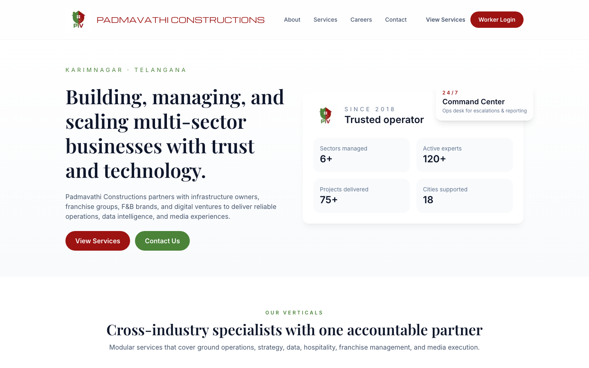
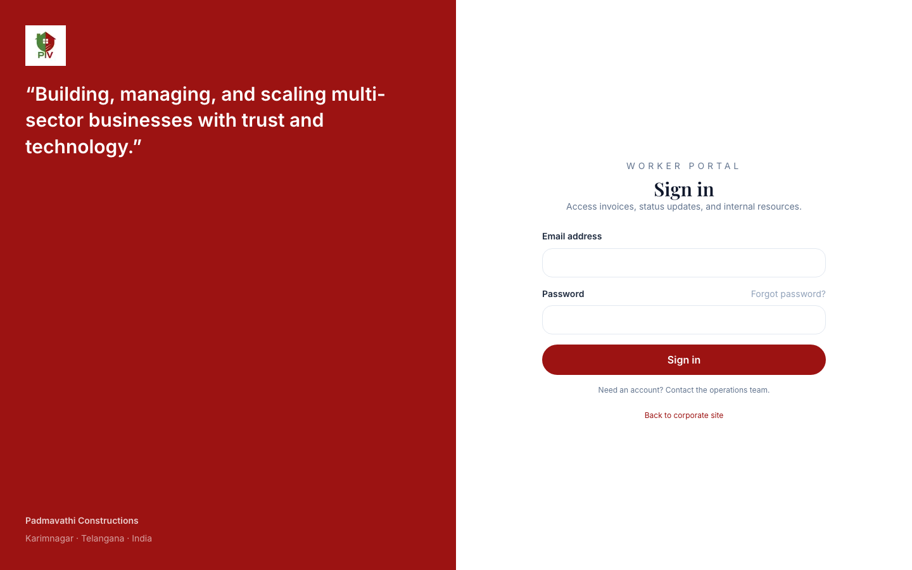

# Padmavathi Constructions — Website & Worker Portal

A Next.js app with two parts: a public company website and a login-protected worker portal for creating and tracking invoices.


[](https://github.com/Theja27153/padmavathi-constructions/actions/workflows/ci.yml)

**Live demo:** <YOUR_DEMO_URL>

| Public site | Worker portal login |
| --- | --- |
|  |  |

## Features

**Public website**
- Home, About, Services, Careers, and Contact pages, rendered from typed data in `data/`
- Service enquiry form (`/api/enquiry`) and careers application form (`/api/careers/apply`)

**Worker portal** (`/portal/*`)
- Email/password sign-in with an HTTP-only session cookie; `middleware.ts` redirects signed-out users to `/login`
- Dashboard with invoice counts by status and recent invoices
- Invoice list, printable invoice detail view, and a create form with line items and GST
- Editable profile

## Tech stack

| Layer | Choice |
| --- | --- |
| Framework | Next.js 16 (App Router, Route Handlers, Middleware) |
| UI | React 19, Tailwind CSS 4 |
| Language | TypeScript (strict) |
| Data | In-memory mock store (`lib/mock-db.ts`) seeded from `data/` |
| Testing | Vitest |
| CI | GitHub Actions — lint, test, build on every push and PR |

## Project structure

```
app/
  (site)/        Public pages sharing the Navbar + Footer layout
  login/         Sign-in page
  portal/        Authenticated worker portal (own layout)
  api/           Route handlers: auth, invoices, profile, enquiry, careers
components/      layout/, ui/, forms/, portal/
data/            Seed data (services, jobs, invoices, users, company info)
lib/             auth.ts (sessions), mock-db.ts (data + validation), utils.ts
types/           Shared TypeScript interfaces
tests/           Vitest unit tests
middleware.ts    Portal route protection
```

## Getting started

Requires Node.js 20+.

```bash
npm ci
npm run dev          # http://localhost:3000
```

| Command | What it does |
| --- | --- |
| `npm run dev` | Start the dev server |
| `npm run build` | Production build |
| `npm start` | Serve the production build |
| `npm run lint` | ESLint |
| `npm test` | Vitest unit tests |

### Demo walkthrough

1. Browse the public site at `/`, then open **Worker Login**.
2. Sign in with one of the seeded demo accounts in [`data/users.ts`](data/users.ts) (fake data, for local demos only).
3. From the dashboard, create an invoice at `/portal/invoices/new`, then open it from the invoice list.

## API notes

| Route | Method | Auth | Notes |
| --- | --- | --- | --- |
| `/api/auth/login` | POST | – | Sets the session cookie |
| `/api/auth/logout` | POST | – | Clears the session |
| `/api/invoices` | GET, POST | Session | POST validates required fields, GST (0–100), and line items; line amounts and totals are recomputed on the server |
| `/api/profile` | POST | Session | Only `name`, `email`, `role`, `department` can be changed; the password is never returned |
| `/api/enquiry` | POST | – | Demo endpoint; returns success without storing data |
| `/api/careers/apply` | POST | – | Demo endpoint; returns success without storing data |

All POST routes return `400` for malformed JSON.

## Limitations

This is a portfolio/demo project, not a production system:

- **Mock auth.** Demo users and plain-text passwords live in `data/users.ts`; sessions are kept in memory.
- **No database.** Invoices and profile edits are stored in memory and reset when the server restarts.
- **No delivery.** Enquiry and careers submissions are not emailed or saved anywhere.
- **No file uploads.** Invoice attachments are placeholders.

## License

[MIT](LICENSE) © <YOUR_NAME> · [LinkedIn](<YOUR_LINKEDIN_URL>)
